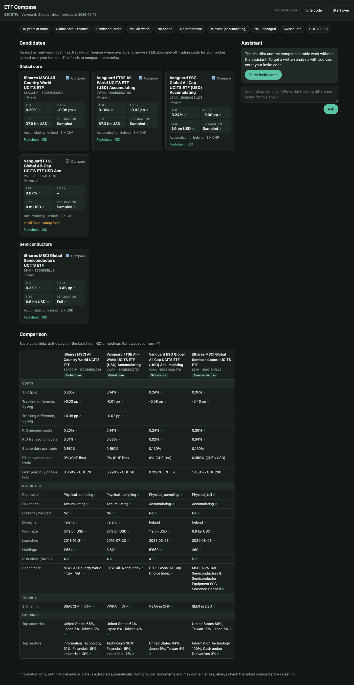
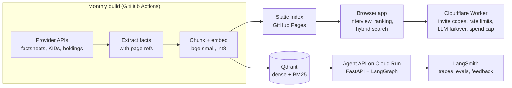

# ETF Compass

A research assistant for Swiss private investors choosing UCITS ETFs. A short interview captures preferences
(diversification, home bias, themes, broker, horizon). The app then shortlists funds, compares their real costs
(TER, tracking difference, Swiss stamp duty, FX) and answers follow-up questions. **Every number links to the page of
the factsheet or KID it came from, and the model can only cite sources that retrieval actually returned.**

It covers 620 ETFs from iShares and Vanguard and is refreshed monthly from the providers' own documents.



## Architecture



There are two serving paths over the same extracted data:

| | Public app (`site/`, `worker/`) | Agent API (`agent/`) |
|---|---|---|
| Pattern | Single-shot RAG: the browser retrieves, the Worker calls the LLM once | Tool-using agent: plans, calls tools, verifies, repairs |
| Retrieval | BM25 + vectors in the browser (static index) | Qdrant hybrid (dense + BM25, RRF) + cross-encoder rerank |
| Runs on | GitHub Pages + Cloudflare free plan (no server cost) | Cloud Run, `europe-west6` (scales to zero) |
| Observability | Worker logs | LangSmith traces, user feedback, eval experiments |

The public app is built to be cheap enough to share with a small group. The agent handles the questions that
single-shot RAG answers badly, such as screening ("accumulating world funds under 0.2% TER, ranked by tracking
difference"), multi-fund cost comparisons and follow-up research.

### The agent

```
START -> agent --(research tool calls)--> tools -> agent ...
               --(final_answer call)-----> verify --(ok / repaired / stripped)--> END
               --(tool budget used up)---> force -> agent
```

| Tool | What it does |
|---|---|
| `shortlist` | Rule-based starting candidates per portfolio role from the interview profile (same logic as the site, parity-tested) |
| `search_funds` | Hybrid search over fund profiles with hard filters (asset class, tags, TER, hedging, income) |
| `query_funds_sql` | One read-only SQLite `SELECT` over the fund facts for exact screening and ranking |
| `get_fund_facts` | Exact facts per ISIN, each with a citable source id (`IE00B4L5Y983-factsheet#p1`) |
| `search_documents` | Passages from factsheets, KIDs and holdings, each with a citable passage id |
| `compare_costs` | Swiss total cost: TER or tracking difference, stamp duty, FX and commission for the investor's broker |

`verify` is deterministic, not another LLM call. Every cited id must exist in the evidence registry filled by the
tools. Every ISIN, picked or just named in the text, must have appeared in a tool result. Every percentage in the
reply must occur in a tool result, the user's question or the profile. The model gets one repair round with the
specific problems; after that, unsupported citations, picks and ISINs are removed and a warning is attached.

## Design decisions

- **Numbers never come from the model.** Cards and tables render extracted values, each linked to its source page.
  The model writes explanations and must cite ids; the browser drops unknown ids and ISINs outside the candidate
  set (`site/js/chat.js`), and the agent's `verify` node does the same server-side.
- **Guardrails in code, not in the prompt.** The SQL tool is read-only by construction: a SQLite authorizer allows
  only `SELECT` on the two fund tables (no writes, `ATTACH`, `PRAGMA`, recursive CTEs or `sqlite_master`), a
  progress handler stops runaway joins, and results are capped (`agent/sql.py`, tested in `tests/test_agent_sql.py`).
- **Retrieval choices are measured, not assumed.** See the table below: hybrid beats either branch alone, and the
  reranker buys passage MRR at about 3x latency, so the agent reranks passages but not fund search.
- **Cost control.** The LLM chain is the free Mistral tier first. A billed Gemini fallback is only used for invite
  codes marked as paid, and only under a daily CHF budget that the Worker's Durable Object reserves before each call
  and settles after it.
- **Domain rules from the source.** Swiss stamp duty is 0.075% for CH-domiciled and 0.15% for foreign funds per trade
  through a Swiss securities dealer, and nothing through a foreign broker (ESTV, *Eidgenössische Stempelabgaben*,
  p. 16-18). Broker FX rates are approximate and labelled as such (`site/rules/ch_trading.json`).
- **Extraction is checked against reality.** Golden tests pin values read from real documents. A guard step stops the
  monthly publish if fewer than 500 funds come through or more than 25% have validation issues.

## Evaluation

**Retrieval** (`python -m agent.eval_retrieval`, 16 passage and 7 fund queries in `eval/queries.json`, k=5):

| Config | Passage recall | Passage MRR | Fund recall | Fund MRR | ms / query |
|---|---|---|---|---|---|
| dense (bge-small) | 0.94 | 0.79 | 1.00 | 0.83 | 39 |
| sparse (BM25) | 1.00 | 0.81 | 0.86 | 0.67 | 113 |
| **hybrid (RRF)** | **1.00** | **0.91** | **1.00** | **0.81** | 141 |
| hybrid + MiniLM rerank | 1.00 | 0.93 | 1.00 | 0.76 | 406 |

**Agent, end to end** (`python -m agent.eval_agent`, 10 cases in `eval/agent_cases.json`). Each case runs the whole
graph and is scored by deterministic evaluators: expected fund found, expected tool used, sources cited, answer
grounded on the first try, no unsupported numbers left, and admits the gap when the documents cannot answer. An
optional LLM judge (`--judge`) adds faithfulness against the tool results. With `LANGSMITH_API_KEY` set, the cases are
synced into a LangSmith dataset and every run becomes an experiment, so prompt or model changes can be compared side
by side. Without a key, the same evaluators run locally.

Latest local run (`eval/results-agent.json`), with `qwen3:8b` through Ollama as a deliberately weak baseline;
production uses Mistral:

| Metric | Score | Cases |
|---|---|---|
| expected tool used | 1.00 | 9 |
| admits gap (unanswerable / out of scope) | 1.00 | 2 |
| grounded after verification | 0.90 | 10 |
| cites sources | 0.86 | 7 |
| expected fund found | 0.75 | 8 |
| grounded on first try | 0.70 | 10 |

Mean latency is 61 s per case on a laptop. The gap between "first try" and "after verification" is the repair round
at work. The eval also caught two bugs in the verifier, both now fixed and covered by tests: its own rejection message
counted as evidence on the second check, and invented ISINs written into the prose (not the picks) went unchecked.
The remaining misses are the small model choosing badly: it ignores the home-bias shortlist and under-filters the SQL
screen.

## Tests

```sh
uv run pytest -q                  # pipeline units, golden values, agent graph, SQL guardrails, API contract, eval scorers
(cd worker && npm test)           # Worker: auth, rate limits, provider failover, paid budget cap
node --test site/test/*.test.js   # browser modules: ranking, costs, search, citation filter
node tools/e2e.mjs                # headless Chrome end to end, screenshots in data/logs/e2e
```

The agent tests run the real LangGraph graph and FastAPI app with a scripted model and an in-memory fund universe
(`tests/agent_fakes.py`), so they need neither an LLM nor Qdrant. CI (`.github/workflows/ci.yml`) runs pytest and
the Worker tests on every push and builds the Docker image. Golden values, the site tests and e2e need downloaded or
published data, so they run locally (golden values also in the monthly refresh).

## Local development

API keys go in `.env` (gitignored; template in `.env.example`) and are passed with `--env-file`. Install the
secret-scanning hook once with `cp tools/pre-commit .git/hooks/`; it blocks commits that contain keys or `.env` files.

```sh
uv sync --group dev --extra agent
uv run python -m pipeline build --providers ishares --limit 10   # or --isins A,B; --max-age-days 7 reuses downloads
uv run python -m pipeline index                                    # load the build into Qdrant (local store in data/qdrant)

# agent: CLI, HTTP API (docs at /docs) and eval; LLM_CHAIN=ollama uses a local model (qwen3:8b)
LLM_CHAIN=ollama uv run python -m agent.run "Which world ETF is cheapest for me?" --profile '{"broker":"ibkr"}'
LLM_CHAIN=ollama uv run uvicorn agent.api:app --port 8080
LLM_CHAIN=ollama uv run python -m agent.eval_agent --local

# public app: three local servers
uv run python -m http.server 8800 --directory site --bind 127.0.0.1
uv run python -m pipeline.serve_embed      # stand-in for Workers AI embeddings (:8788)
node --env-file=.env tools/dev-worker.mjs # real Worker logic, invite code "dev-code" (:8787); scripted model
                                           # without MISTRAL_API_KEY, or OLLAMA_MODEL=qwen3:8b for a local one
```

Tracing: set `LANGSMITH_TRACING=true`, `LANGSMITH_API_KEY` and `LANGSMITH_PROJECT`. Every agent run is traced with
tags (`api`, `cli`, `eval`) and metadata (LLM chain, broker). `/chat` returns the run id, and `/feedback` attaches a user
score to that trace.

## Deployment

| Part | Where | How |
|---|---|---|
| Data | `data` branch | `refresh.yml`, monthly: build, test, guard, publish, update the Qdrant index |
| Public site | GitHub Pages | `pages.yml` |
| Worker | Cloudflare | `wrangler deploy` in `worker/`; secrets `MISTRAL_API_KEY`, `GEMINI_API_KEY`, `CODES` (see [docs/invite-codes.md](docs/invite-codes.md)) |
| Agent API | Cloud Run, `europe-west6` | `deploy-agent.yml`: test, build, push to Artifact Registry, deploy, smoke test |

The agent deploy is keyless: GitHub Actions authenticates through Workload Identity Federation, and API keys live in
Secret Manager, readable only by the runtime service account. `tools/gcp-setup.sh` creates all of this once and prints
the repository variables to set. Retrieval in Cloud Run uses Qdrant Cloud (`QDRANT_URL`); the query-time models are
baked into the image, so cold starts download nothing.

The threat model and the controls on each part are in [SECURITY.md](SECURITY.md).

## Data sources

| Provider | List | Documents | Notes |
|---|---|---|---|
| iShares | Screener JSON (CH site) | Factsheet, PRIIPs KID, holdings CSV | PDFs need `siteEntryPassthrough=true`. German-domiciled funds have no English KID on the Swiss site. |
| Vanguard | GraphQL (`X-Consumer-ID: ch0`) | Factsheet, PRIIPs KID | Funds younger than one calendar year publish no performance yet. |
| Xtrackers, UBS | Not yet | | Their sites require accepting an investor/terms gate first; whether to automate that is still open. |

Information only, not financial advice.
